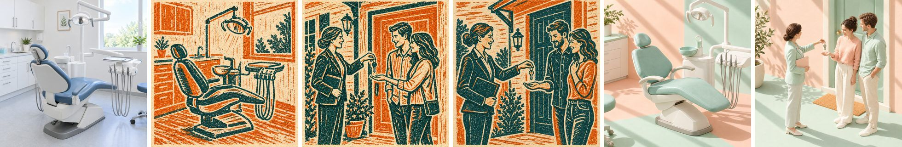
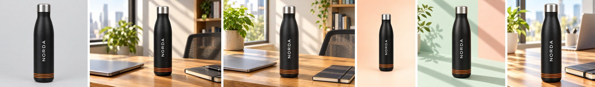
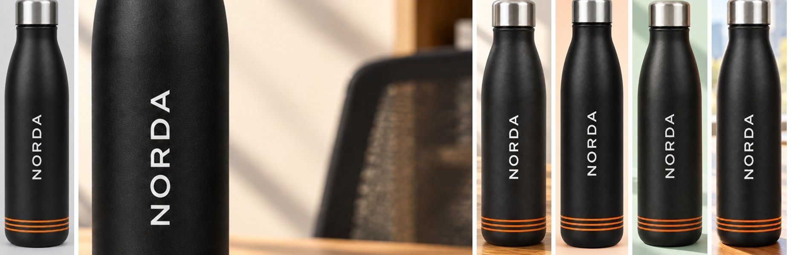
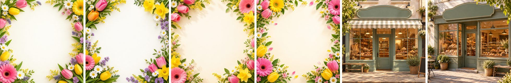
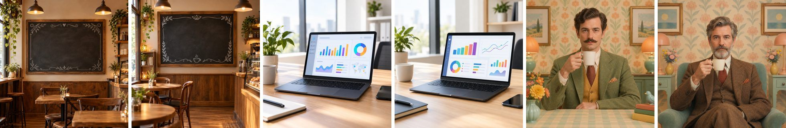

# Image references, product photos and the no-text rule: live eval

Owner: contivo-cpo (for contivo-head-of-data). Date: 2026-11-23. Spec it feeds:
`docs/superpowers/specs/2026-11-23-brand-image-styles-design.md`.

**Question.** Can our image models (`gpt-image-2.5-flare`, falling back to `gpt-image-2.6-flare`
and `gpt-image-2.5-sunburst`, see `apps/web/src/lib/ai/image.ts`) do three things?

- (a) follow a style from 3–5 reference images;
- (b) edit or reframe a real product photo without distorting the product;
- (c) keep the no-text rule when the user's own prompt asks for text.

**Cost: US$0.86** for 43 images and 6 text calls, against a cap of $5 (details in
[Cost](#cost)). Every picture is in `2026-11-23-image-reference-eval/`. Open the `sheet_*.jpg` files
first. The scripts are in `scripts/` (they read `OPENAI_API_KEY` from the environment).

## Verdicts

| | Verdict | In one line |
|---|---|---|
| **(a) Style from references** | **Yes, works today** | 6 of 6 outputs took the medium, palette, texture and light of the references, and none copied their subjects. It costs 3–3.5× a normal image. |
| **(b) Product photo edit** | **Yes for reframing. No for a guarantee.** | In 5 of 5 edits the wordmark, rings, cap and shape survived. But the model redraws the whole picture, even under a mask, so "the product is never altered" can only be promised by compositing the original pixels, not by the model. |
| **(c) No text when the user asks for text** | **No with a prompt wrapper. Yes with a rewrite step.** | When the user's words go to the model wrapped in our rules, 9 of 10 pictures contained the requested text, including legible Persian with a wrong number. When a text model rewrites the request first, 12 of 12 were clean. |

## Method

- Endpoints: `/v1/images/generations` (text only, as production uses today) and
  `/v1/images/edits` with several `image[]` files (references and photos). Quality `medium`,
  `n=1`, on the local OpenAI key (same org as production; the model list matches the 22 Nov eval).
- **Inputs were generated, not real** (see `sheet_inputs.jpg`):
  - two reference sets: a linocut set (4 images, burnt orange and teal on cream) and a pastel
    studio-photo set (3 images, mint and peach, hard diagonal sun);
  - a stand-in "user product photo": a black bottle with a white `NORDA` wordmark and exactly
    three orange rings, on grey.

  This is the main limit of the eval. Real user uploads are noisier: mixed styles, phone
  photos, small print, reflections, faces. Results on real uploads will be worse than here,
  not better.
- The style prompts **never describe the style in words.** They only say "match the visual
  style of the reference images; do not copy their subjects". Any style in the output came
  from the pictures.
- I judged every picture by eye at full size, and zoomed into product labels and laptop screens.
  For the masked edit, I also measured the pixel difference.

## (a) Style from 3–5 reference images

From left to right:

1. **Control:** text only, no references (dentist chair).
2. **Linocut set:** dentist chair.
3. **Linocut set:** realtor handing keys.
4. Same as 3, but on `gpt-image-2.6-flare`.
5. **Pastel studio set:** dentist chair.
6. **Pastel studio set:** keys.

- **Style transfer is strong.** The linocut outputs keep the two inks, the carved gouge marks,
  the paper grain and the cream ground. The pastel outputs keep the mint and peach planes, the
  hard diagonal shadows, the high-key light and the slightly overhead angle. No subject was
  copied: there are no bicycles, cups or towels in the outputs.
- **The post's subject still comes through.** You can read the dentist chair and the key
  handover at once. People drawn in the linocut style stay coherent: hands, keys and faces are
  fine.
- **Both models work.** 2.6-flare gave a near-identical result at 1.7× the price
  (1,449 output tokens against 439).
- **Latency:** 19–27 s, against about 12 s for text only.
- **Cost per image:** **$0.038 with 3 references, $0.047 with 4**, against $0.013 for text
  only. Every reference costs 1,024 image-input tokens, about $0.008. The edits endpoint gets
  no cached-input discount.

**Not tested:**

- References that disagree with each other.
- References that contain logos or text, which may leak into outputs.
- A cheaper route: describe the references once as a text "style card" and generate text-only
  from it. The text prompts that made the reference sets produced the style at $0.013, which
  suggests this route works. Measure it before choosing (see the spec, §4.3).

## (b) Reframing a real product photo

From left to right:

1. **Input.**
2. On a desk, 16:9-class landscape (1536×1024).
3. Same, on 2.6-flare.
4. Background swap, portrait (1024×1536).
5. Brand look taken from the pastel references.
6. Masked edit: only the background is editable.

- **The product survives.** In all 5 outputs:
  - `NORDA` is spelled correctly, vertical, in the same typeface;
  - there are exactly three rings;
  - the cap is brushed steel;
  - the proportions hold (height/width 3.79–3.90 against 3.84 in the input).

  The bottle re-lit naturally in each new scene.
- **`input_fidelity` is not supported.** Both flare models reject `input_fidelity=high|low`
  with `400 invalid_input_fidelity_model`. We cannot ask for "keep the input exact"; we can only
  say it in the prompt.
- **A mask does not lock pixels.** The masked edit protected the bottle area, but the model
  still re-rendered it:
  - mean difference inside the protected area: **9.8/255**;
  - pixels changed by more than 40: **4%**.

  The output looks the same, but it is not the user's photo. For a product whose label carries
  regulated or legal text (food, pharma), that is not good enough.
- **Cost:** $0.019 (1536×1024) to $0.022 (1024×1024) per edit with one photo, and $0.047 when
  combined with 3 style references.

**Not tested:**

- Real phone photos.
- Small print, multi-line labels, transparent or reflective products.
- **Team photos with faces.** I did not test editing people. A model that redraws a face
  produces a different person, and that is a consent problem as well as a quality problem.

## (c) The no-text rule against a user prompt that asks for text

### Wrapper only: the user's prompt inside our rules, sent as is

The wrapper is in `wrapper-prompt.txt`. It says that no text of any kind is allowed, that a
requested sign, poster, menu or screen must be blank, and that these rules win over the request.

| Request | No wrapper | Wrapped, run 1 | Wrapped, run 2 |
|---|---|---|---|
| "poster that says SPRING SALE 30% OFF" | text | **text** | **text** |
| «پوستر … با نوشته‌ی بزرگ «حراج بهاره ۳۰٪ تخفیف»» | legible Persian | **legible Persian, wrong number (۱۳٪)** | **legible Persian** |
| bakery sign "Golden Crust" | — | **text** | **text** |
| chalkboard menu with prices | — | `$` signs | clean |
| laptop showing revenue numbers | — | **numbers** | **numbers** |

**The result is 1 clean picture out of 10.** Quoted words in the user's prompt beat our rules.
The model now writes Persian well enough to be tempting. It is still not reliable: it turned
۳۰٪ into ۱۳٪. A wrong price on a customer's post is worse than no image.

### Rewrite first, then wrap

A text model (`gpt-4.1-mini`, prompt in `sanitizer-system-prompt.txt`) turns the request into a
picture description. It:

- drops every word the user wants shown;
- turns a text-bearing surface into a blank one;
- removes named brands, artists and people.

Its outputs are in `sanitized-prompts.jsonl.txt`.

- **12 of 12 were clean**, Persian included. The poster became a flower frame with an empty
  middle, which is the right input for our own Vazirmatn text overlay. The sign is blank. The
  chalkboard is empty. The dashboards show charts with no digits; I zoomed in to check
  (`S5_zoom.jpg`).
- **Named things.** "Our CEO in the style of Wes Anderson holding a Starbucks cup" was handled
  this way:
  - the brand and the person were removed (a fictional man, a plain cup);
  - but the rewrite described the director's look ("symmetrical, pastel, quirky filmmaking"),
    and the output is recognisably that look.

  Removing a name does not remove a style. Whether that is acceptable is a policy question
  (see the spec, open question 4).
- **Cost of the rewrite:** about **$0.0002 per call**. It adds about 1–2 s.
- **Sample size:** 2 runs per prompt. This is enough to show the wrapper fails, but not
  enough to call the rewrite reliable. Before launch, build a regression set of about 30
  text-baiting prompts, in English and Persian, and add an after-the-fact check (spec §5.3).

## Cost

Usage comes from each response's `usage` block, priced at the list price on
developers.openai.com/api/docs/pricing (read 23 Nov):

- `gpt-image-2.5-flare`: text in $5, image in **$8**, image out $30 per 1M tokens;
- `gpt-4.1-mini`: $0.40 in, $1.60 out per 1M tokens.

The per-call rows are in `usage.jsonl`.

| Call type | $ per image | Calls here |
|---|---|---|
| Text only, 1024² medium (today's production call) | 0.013–0.014 | 31 |
| Edit with 1 photo, 1536×1024 | 0.019 | 2 |
| Edit with 1 photo + mask, 1024² | 0.022 | 1 |
| 3 references | 0.038 | 2 |
| 4 references (or 1 photo + 3 references) | 0.047 | 3 |
| 2.6-flare, 4 references | 0.077 | 1 |
| 2.6-flare, 1 photo, 1536×1024 | 0.043 | 1 |
| Prompt rewrite (gpt-4.1-mini) | 0.0002 | 6 |
| **Total** | **$0.856** | 43 images + 6 rewrites |

Five more calls failed with 400 (`input_fidelity`) and were not billed.

**Production `AiUsageLog`: not read.**

- This session was not allowed to query the production database.
- The local database has 70 usage rows and **no `content_image` row**.

So there are no real per-image costs from production yet. The numbers above are measured on
real API calls, but they come from this eval, not from customer traffic.

**Bug found in passing.** `apps/web/src/lib/ai-usage.ts` prices image models at the
**text-input** rate ($5) only. Once edits ship, image-input tokens ($8) will be under-recorded.
Follow-up for contivo-head-of-data.

## What this means

| Capability | Feasible now with OpenAI? | What it needs |
|---|---|---|
| Brand look from 3–5 references | **Yes** | A new edits call in `ai/image.ts` with the same model chain. The cost (3–3.5×) argues for a text "style card" route; measure it first. |
| Reframe or re-light a product photo | **Yes, looks right; not pixel-exact** | Fine for "lifestyle" shots. Label it "AI-edited" in the UI. |
| Put the user's product or team photo in our template untouched | **Not a model job** | Background removal plus compositing. A cut-out library or a vendor (an open question; not an image-model provider). Team photos with faces: crop and frame only, never sent to the model to edit. |
| Text on the image (Persian included) | **Never from the model** | Our own template renderer with Vazirmatn. **It does not exist yet**; there is no overlay or carousel code in `apps/web` today. |
| No-text rule with a user prompt | **Yes, with a rewrite step + a check after generation** | The rewrite is cheap. Add an OCR/vision check of every output before it is attached. |
| A second provider for edits | **No fallback today** | Gemini image has no quota on our key (429), so one OpenAI outage stops all edits. The text-only path has the same gap. |
